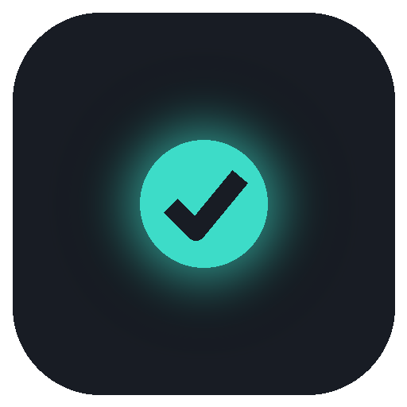
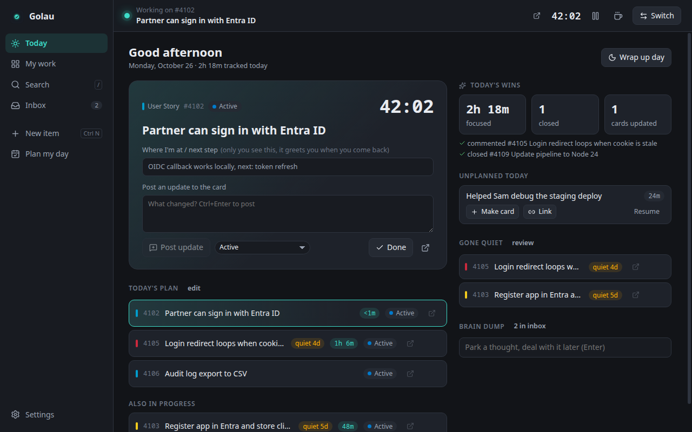
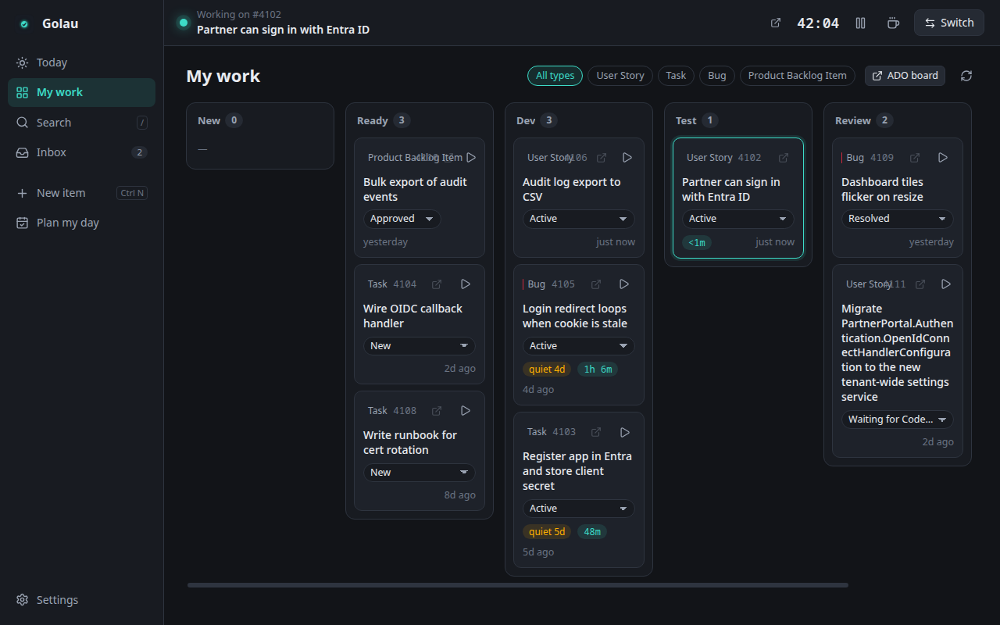
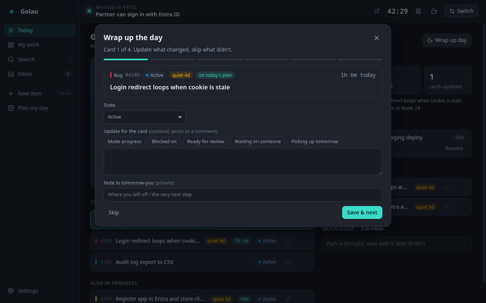
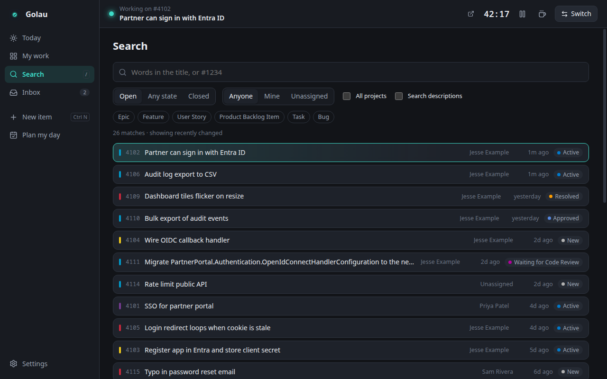
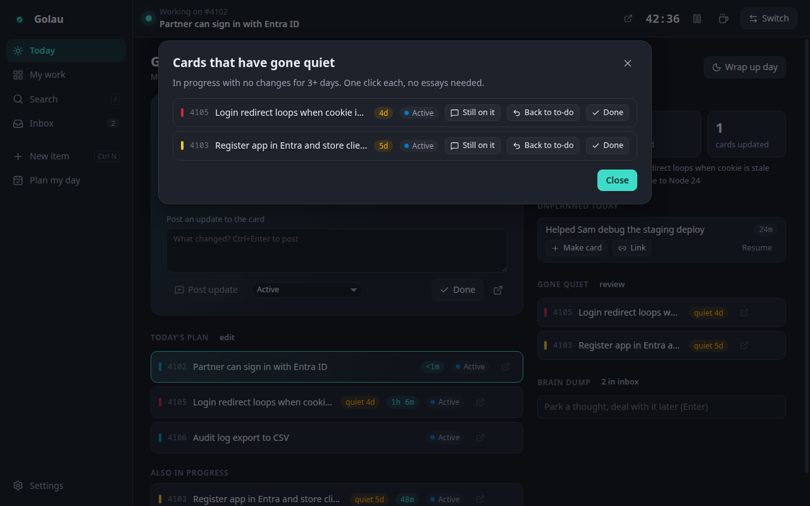
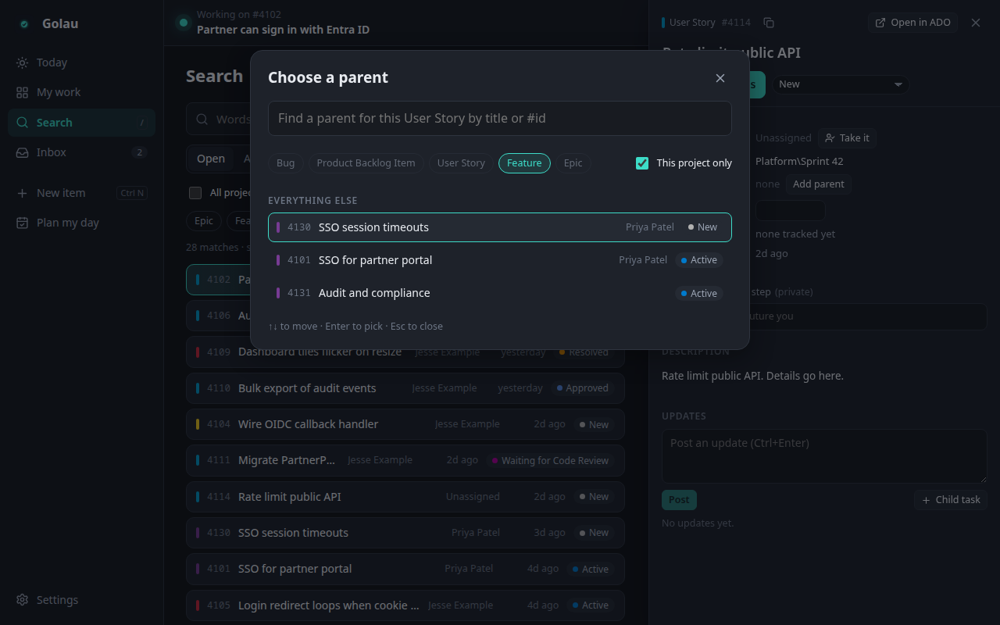
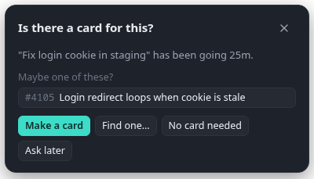

<div align="center">



# Golau

**A focus companion for Azure DevOps, built for an ADHD brain.**

*Golau* (Welsh, "GOL-eye") means **light**. Formerly Tasklight; upgrading keeps your settings.

[](../../releases)
[](../../actions/workflows/ci.yml)
[](LICENSE)


[Install](#install-windows) · [What it does](#what-it-does) · [Security](#security) · [Develop](#develop)



</div>

## Why

Boards go stale because updating them is a chore at exactly the moment you're deep in something else. Golau keeps **one card in focus**, times it, nudges gently, and turns keeping cards updated into a 3-minute habit instead of a guilt pile.

- Runs **locally** (Electron). Windows is the main target; Linux works too.
- Your PAT is encrypted with the OS keystore (DPAPI on Windows) and only ever talks to `dev.azure.com`.
- No telemetry, no accounts, no cloud. Free software (GPL-3.0-or-later).

## Install (Windows)

1. Download the latest `Golau-Setup-<version>.exe` from [Releases](../../releases) and run it. SmartScreen may warn because it's unsigned: **More info → Run anyway**.
2. It installs just for you, with **no admin prompt**, into `%LOCALAPPDATA%\Programs\Golau`, adds a Start menu shortcut and starts the app.
3. Paste your org URL + a PAT with **Work Items: Read & write** (+ **Project and Team: Read** to pick a team).

Everything stays in your user profile: the app in `%LOCALAPPDATA%\Programs\Golau`, your settings and encrypted token in `%APPDATA%\Golau`, the uninstall entry and the optional *Start with Windows* entry under `HKEY_CURRENT_USER`. Golau checks for new versions itself (Settings → Updates: tell me / install automatically / off); you can also just run a newer setup. To remove, use Settings → Apps (your settings folder is kept; delete it by hand for a clean slate).

Settings → *Start with Windows* makes it launch to the tray at login.

## What it does

| Feature | What you get |
|---|---|
| **Focus** | One card at a time, big timer, "where I left off" note that greets you when you come back. Floating always-on-top focus bar. |
| **Unplanned work** | Just type what you're doing. After 20 min it asks (once) if there's a card for it, with suggestions. Link it, make one, or say no card needed; time moves to the card. |
| **Check-ins** | "Still on this?" every 45 min, auto-dismisses as *yes*. Nothing tracked for 15 min while you're active? It asks what you're on. |
| **Morning plan** | Pick 1–3 cards that would make today a win; yesterday's leftovers come pre-ticked. |
| **Gone quiet** | Cards in progress with no changes for 3+ days: one-click *still on it / back to to-do / done*. |
| **Wrap up** | End of day, card by card: state, a quick update (chips for common ones), log hours, a note for tomorrow-you. Then sort the unplanned stuff. |
| **Away / breaks** | Timer pauses on idle, lock or sleep, and asks to resume when you're back. Suggests a break after 90 min straight. |
| **Brain dump** | `Ctrl+Alt+Space` anywhere: Enter parks a thought in the inbox, Ctrl+Enter starts tracking it. |
| **Board, search, create** | My work as columns with inline state changes; search everything (title/#id, type, state, assignee, all projects); create items with parent, tags, sprint, estimate; set, change or remove a card's parent from its panel (search by type, this project or all). |
| **BUSY Bar** | Optional: shows the focused card + timer on the Bar's front display (priority below Home Assistant so meeting text wins). |

### Tour

<table>
<tr>
<td width="50%"><br><sub><b>Board.</b> Your team's real ADO columns; drag a card to change its state.</sub></td>
<td width="50%"><br><sub><b>Wrap up.</b> State, a quick update, hours and a note for tomorrow-you.</sub></td>
</tr>
<tr>
<td width="50%"><br><sub><b>Search.</b> Title or #id, type, state, assignee, all projects.</sub></td>
<td width="50%"><br><sub><b>Gone quiet.</b> Stale cards: still on it, back to to-do, or done.</sub></td>
</tr>
<tr>
<td colspan="2"><br><sub><b>Parent picker.</b> Search for a parent by type; the level ADO expects is ticked, the rest are one tap away.</sub></td>
</tr>
</table>

<p align="center"><br><sub><b>Nudges</b> are small, one at a time, and always have a no-guilt "later".</sub></p>

Nudges only fire in your work hours, never while you're idle, one at a time, and every one has a no-guilt "later". Tray → *Quiet for…* silences them for a focus block.

> **Keys:** `Ctrl+K` switch task · `Ctrl+N` new item · `/` search · `Ctrl+Alt+Space` brain dump · `Esc` close

## Security

Built to be safe on a work machine. In short: the token never leaves Azure DevOps, the UI has no network, and work-item HTML is treated as hostile.

<details open>
<summary><b>Full list</b></summary>


- **Token:** stored only encrypted (Windows DPAPI via Electron safeStorage); if no OS key store exists it stays in memory. It's only ever sent to `https://dev.azure.com/<org>` or `https://<org>.visualstudio.com`, redirects aren't followed, and it's never logged.
- **Untrusted work item HTML** (descriptions, comments by other people) is sanitized with DOMPurify: scripts, iframes, SVG, forms and inline styles are stripped, links survive only as absolute `http(s)` URLs that open in your browser, and images become `[image]` links so nothing is fetched (no tracking pixels, no `\\host\share` paths that would leak Windows credentials).
- **The UI has no network access at all**: every request from the web layer except the app's own files is cancelled; Azure DevOps and the BUSY Bar are called from the main process. CSP is `default-src 'none'`.
- **Electron hardening:** sandboxed renderers, context isolation, no Node in the UI, no webviews, navigation and new windows blocked, all browser permissions denied, IPC accepts calls only from the app's own page and only for known methods, with ids and field names validated.
- **Packaged exe:** fuses disable run-as-Node, `NODE_OPTIONS` and `--inspect`; only the integrity-checked `app.asar` loads; DevTools and the dev/test switches (`GOLAU_*`, `ELECTRON_RENDERER_URL`) are off.
- **Updates:** only from this repository's GitHub releases over HTTPS, only newer non-prerelease versions, downloads only from GitHub hosts, size-capped, and the installer must match the release's `SHA256SUMS.txt` before it runs. It runs as you (per-user, no admin) and upgrades in place. Releases aren't code-signed, so this guards against corruption and tampering in transit, not against a compromised GitHub account.
- **Data:** `state.json`/`settings.json` are written atomically (fsync + rename) with a `.bak`; after a crash or forced reboot the running timer is cut off at the last minute the app was alive instead of counting the downtime.
- Not code-signed: SmartScreen warns, and a locked-down laptop (AppLocker/WDAC) may refuse to run unsigned apps.

</details>

## Develop

```bash
npm ci && node node_modules/electron/install.js   # npm 12 blocks Electron's postinstall
npm run mock     # fake ADO at http://localhost:7071/mockorg (project Platform), any PAT
npm run dev      # app with hot reload
npm test         # nudge-rule + security tests
npm run shots    # renders every screen offscreen to .shots/*.png (needs the mock running)
npm run dist:win # dist/Golau-<version>-win.zip (builds from Linux; rcedit runs under wine)
```

Data lives in `%APPDATA%\Golau` (`settings.json`, `state.json`, `secrets.bin`). `GOLAU_DATA` overrides it when running from source (ignored in the packaged app).

<details>
<summary><b>CI and releases</b></summary>

- **CI** (`.github/workflows/ci.yml`, every push/PR): typecheck, tests, audit of shipped deps, an offscreen run of every screen against the mock (screenshots uploaded as an artifact; fails if the hostile-HTML check finds anything), and a Windows installer build with a fuse check and a real install/launch/uninstall test (setup exe uploaded as a 7-day artifact).
- **Release** (`.github/workflows/release.yml`): builds the per-user installer, installs/launches/uninstalls it on a Windows runner as a test, then publishes. Bump `version` in `package.json`, commit, then

  ```bash
  git tag vX.Y.Z && git push origin vX.Y.Z
  ```

  The tag must match `package.json`. It builds natively on Windows, verifies fuses, and publishes a GitHub Release with the setup exe and `SHA256SUMS.txt`. A hyphenated tag (`vX.Y.Z-beta.1`) becomes a prerelease.

Actions are pinned to commit SHAs; the job that can write to the repo runs no project code.

</details>

<details>
<summary><b>Layout</b></summary>

- `src/main/ado.ts`: Azure DevOps REST client (WIQL, batch, comments, create, update)
- `src/main/tracker.ts`: the local journal: focus, sessions, unplanned work, inbox, plans
- `src/main/scheduler.ts`: when to nudge (tested in `test/scheduler.test.mts`)
- `src/main/busybar.ts`: BUSY Bar display
- `src/renderer/src/views/*`: screens; `surfaces.tsx`: nudge card, focus bar, capture box

</details>

## Code signing policy

Releases are **not code-signed**, so Windows SmartScreen warns on first run (More info → Run anyway). To check a download is the one CI built, compare `Get-FileHash Golau-Setup-*.exe` with the release's `SHA256SUMS.txt`.

Every release is built by GitHub Actions on GitHub-hosted runners from a version tag in this repository ([release workflow](.github/workflows/release.yml)). The workflow can sign through SignPath if that's ever set up ([docs/signpath.md](docs/signpath.md)); those steps are skipped today.

### Privacy policy

This program will not transfer any information to other networked systems unless specifically requested by the user or the person installing or operating it.

In practice: Golau talks only to the Azure DevOps organization you configure (to read and update your work items), to GitHub to check this project's releases for a newer version every few hours (turn it off in Settings → Updates; the request carries nothing about you or your work), and, if you turn it on, to the BUSY Bar address you enter on your local network. Links open in your own browser when you click them. There is no telemetry, analytics or crash reporting, and the app's interface itself has no network access (see [Security](#security)). Your settings and encrypted token stay on your machine.

## License

Copyright © 2026 shatteredeagle

Golau is free software: you can redistribute it and/or modify it under the terms of the GNU General Public License as published by the Free Software Foundation, either version 3 of the License, or (at your option) any later version. It is distributed in the hope that it will be useful, but WITHOUT ANY WARRANTY; without even the implied warranty of MERCHANTABILITY or FITNESS FOR A PARTICULAR PURPOSE. See [LICENSE](LICENSE) for the full text.

Bundled third-party libraries keep their own licenses (MIT, ISC, Apache-2.0/MPL-2.0); the app ships them in `THIRD_PARTY_NOTICES.txt` next to `LICENSE.txt` in its `resources` folder.
